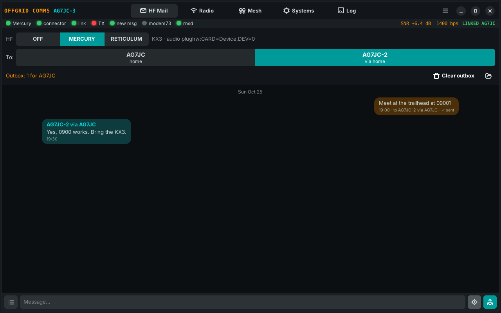
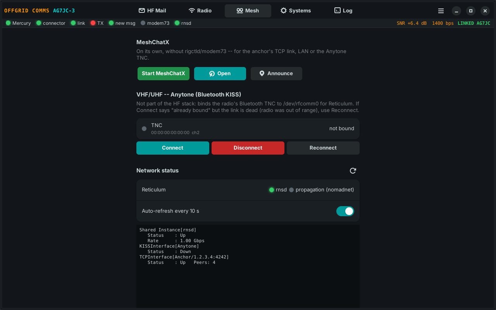
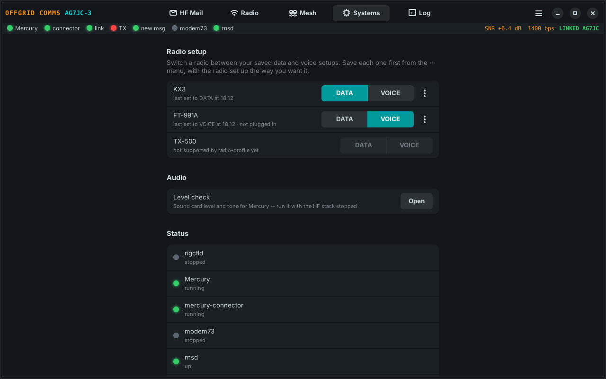
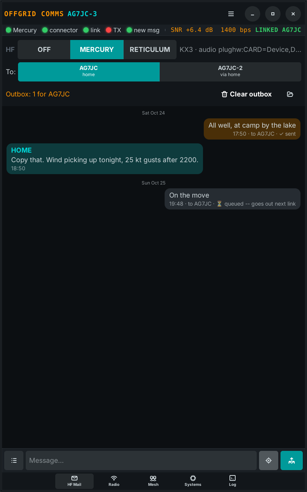

# OffGrid Comms

One window for a portable ham station with no internet: HF mail over [Mercury](https://github.com/Rhizomatica/mercury), Reticulum over HF or a mesh, a Bluetooth KISS TNC, and switching the radio between data and voice setups.



It runs on a laptop and a touchscreen tablet (GNOME, Wayland) with the same code. On a narrow screen the page switcher moves to the bottom, like a phone app.

## What it does

- **HF Mail**: a chat-style inbox over Mercury and mercury-connector. Short reports and replies go to your home station, and through home to your other portable stations. Optional GPS position, quick messages, and a warning before anything queued goes out on the air.
- **HF switch, OFF | MERCURY | RETICULUM**: only one program has the HF radio at a time. Mercury is HF mail; Reticulum is rigctld + modem73.
- **Mesh**: start and stop MeshChatX, bind an Anytone AT-D890UV's built-in Bluetooth KISS TNC for Reticulum on VHF/UHF, and watch `rnstatus`.
- **Systems**: one tap between saved DATA and VOICE setups on the FT-991A or KX3 (through [radio-profile](https://github.com/Saltyhaus/radio-profile)), a sound-card level check for Mercury, and the status of every part of the stack.
- A status strip that's always visible: Mercury, connector, link, TX, new message, modem73, rnsd, plus SNR and speed while linked.
- While anything HF is running, the machine won't suspend on its own, so a transmission isn't cut off.

| Mesh | Systems |
|---|---|
|  |  |



## What you need

- Debian or Ubuntu with GNOME. GTK 4 and libadwaita 1.4 or newer for this window; with older ones it falls back to a plain Tk window.
- For HF mail: **Mercury** (`mercury` on your PATH) and **mercury-connector** (the binary path is `mercury.connector_binary` in the config). Stock mercury-connector is fine on a portable station. The home end needs something that reads the spool and answers; mine is a patched connector, see [mercury-connector-fork](https://github.com/Saltyhaus/mercury-connector-fork).
- For Reticulum over HF: **Hamlib** (`rigctld`) and **modem73**, plus an interface for it in `~/.reticulum/config`.
- For the mesh: **MeshChatX** in the app's venv (the `meshchatx` command).
- For the Anytone TNC: BlueZ's `rfcomm` and one sudoers line (below).

You don't need all of it. Whatever isn't installed just shows as stopped.

## Install

```
git clone https://github.com/Saltyhaus/offgrid-comms.git
cd offgrid-comms
MERCURY_CALL=N0CALL-2 ./install.sh
```

`MERCURY_CALL` is this machine's callsign for Mercury, with an SSID (one per portable: -2, -3...). The installer:

- puts in the GTK packages
- makes a venv at `~/reticulum-venv` with Reticulum in it (set `VENV=` to use another)
- writes `~/.config/offgrid-comms/config.json` with your callsign
- adds the app to the app grid

Then edit `~/.config/offgrid-comms/config.json`:

| Setting | What to put |
|---|---|
| `radios.<name>.device` | your radio's CAT port; use the `/dev/serial/by-id/...` path, which doesn't move between reboots |
| `radios.<name>.mercury_audio` | the radio's sound card for Mercury, e.g. `plughw:CARD=CODEC,DEV=0` (menu › **List sound cards**) |
| `mercury.peers` | the home station your connector calls, e.g. `["N0CALL"]` |
| `mercury.field_stations` | your other portable stations, so you can message them through home |
| `anytone.mac` | the radio's Bluetooth address (`bluetoothctl devices`) |

Start it from the app grid, or the first time from a terminal to see any errors:

```
./run.sh
```

### Anytone Bluetooth TNC

`rfcomm bind` needs root. So the app doesn't ask for a password every time, allow just that command (your user, your radio's address, colons escaped):

```
sudo visudo -f /etc/sudoers.d/offgrid-anytone
youruser ALL=(root) NOPASSWD: /usr/bin/rfcomm bind rfcomm0 AA\:BB\:CC\:DD\:EE\:FF 2, /usr/bin/rfcomm release rfcomm0
```

## HF mail files

Messages are small text files in `~/hf_spool/` (`outgoing/<CALL>/`, `incoming/`, `sent/`), a few header lines and then the text:

```
type: report
callsign: N0CALL-2
category: status
to: N0CALL-3          (optional: relay through home to this station)
lat: 45.5100          (optional)
lon: -122.6800

At camp by the lake, all well.
```

mercury-connector carries them. Whatever runs at home decides what to do with them. Mine puts them on a dashboard and relays `to:` messages on to the other station.

## Good to know

- **The radio is live.** Anything in the outbox goes out as soon as Mercury and the connector are up, so the app asks first when there is.
- Old window: `OGC_UI=tk ./run.sh`, or `"ui_toolkit": "tk"` in the config.
- Tests: `python3 -m unittest test_systems_page`

## License

GPL-3.0-or-later. 73 de AG7JC.
